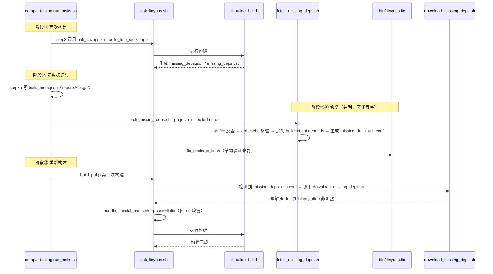

# 端到端集成时序

本 skill 是 compat-testing → fetch → pak_linyaps 三阶段流水线的中间环节。

## 时序图

## 阶段表

| 阶段 | 执行者 | 关键产物 | 数据流向 |
|------|--------|----------|----------|
| ① 首次构建 | `compat-testing` step3（`run_tasks.sh` L196-255）调用 `pak_linyaps.sh --build_tmp_dir=<tmp>` | `missing_deps.json` / `missing_deps.csv` | `ll-builder build` 在 `<tmp>/<basename(project_dir)>/` 内生成 |
| ② 元数据归集 | `compat-testing` step3b（`run_tasks.sh` L441-466） | `build_meta.json`（`reports/<pkg>/`） | 字段 `build_tmp_dir` / `project_dir` / `missing_deps_json` / `missing_deps_csv` |
| ③ 依赖分析 | `fetch_missing_deps.sh --project-dir=<proj> [--build-tmp-dir=<tmp>]` | 更新的 `templates/linglong.yaml` + `missing_deps_urls.conf` | apt-file 反查（L101-109）→ apt-cache 核验（L114-133）→ ruamel.yaml 追加（L144-177）→ apt-get download --print-uris（L192-207）→ 生成 conf（L210-222） |
| ④ 结构修复（并列） | `bin2linyaps.fix`（`fix_package_id.sh`） | 修复后的结构文件 | 修复验证报告结构问题，与本 skill 并列 |
| ⑤ 重新构建 | `pak_linyaps.sh` `build_pak()` | 最终玲珑包 | download_missing_deps.sh（deb L1039-1048 / appimage L793-802 / tar L973-982）→ handle_special_paths.sh libfix（deb L1053 / appimage L807 / tar L987）→ `ll-builder build` |

## 数据流向说明

- ③（依赖分析）和 ④（结构修复）无数据依赖，可任意顺序或并行执行。
- ⑤（重新构建）必须在 ③ 完成后才有意义：`pak_linyaps.sh` 需检测到 `missing_deps_urls.conf` 才会触发 `download_missing_deps.sh`。

## 关键产物路径表

| 产物 | 路径 | 说明 |
|------|------|------|
| `missing_deps.json` | `<build_tmp_dir>/` | `ll-builder build` 生成的缺失依赖报告（JSON） |
| `missing_deps.csv` | `<build_tmp_dir>/` | `ll-builder build` 生成的缺失依赖报告（CSV） |
| `build_meta.json` | `reports/<pkg>/` | 元数据归集，含构建路径与 missing_deps 路径 |
| `missing_deps_urls.conf` | `<project_dir>/` | URL 配置，与 `pak_linyaps.sh` 同级 |
